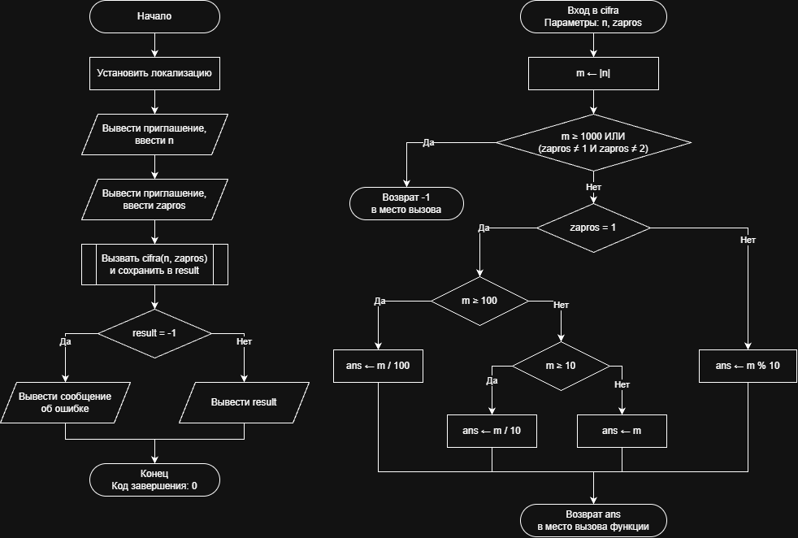

# Домашнее задание к работе 6

## Условие задачи
Дано число N (N<1000). Написать программу, которая по запросу
пользователя выведет последнюю или первую цифру введенного числа.
(https://drive.google.com/file/d/1GiiUloWsMIb8fpSKeDaGTHtNVitsUYZ6/view)

## 1. Алгоритм и блок-схема

### Алгоритм
1. **Начало**.
2. Инициализация окружения: установка локализации UTF-8 для корректного вывода символов.
3. Ввод исходных данных с клавиатуры:
	• Ввести целое число n (\(N < 1000\))
	• Ввести код запроса пользователя zapros (1 — первая цифра, 2 — последняя цифра)
4. Вызов функции: передать значения n, zapros в функцию cifra и дождаться ответа.
5. Вывод результата:
	• Если полученное значение переменной result равно -1, вывести сообщение об ошибке.
	• Иначе вывести полученное значение переменной result на экран.
6. Конец.
Часть 2: Расчетная функция (cifra)
1. Начало функции: получение параметров n, zapros.
2. Вычисление модуля числа: m = |n|.
3. Проверка корректности данных: если m >= 1000 или zapros не равен 1 и не равен 2, вернуть значение -1 обратно в вызывающую функцию (main) и завершить работу.
4. Определение первой цифры (при zapros == 1):
	• Если m >= 100, то ans = m / 100
	• Иначе если m >= 10, то ans = m / 10
	• Иначе ans = m
5. Определение последней цифры (при zapros == 2): ans = m % 10.
6. Возврат значения: передать значение ans обратно в вызывающую функцию (main) и завершить работу.
7. **Конец**

### Блок-схема
 

https://github.com/stzraw/lab-6-VSTU-HW/blob/main/lab_6_schema.png

## 2. Реализация программы

#include <stdio.h>
#include <stdlib.h>
#include <locale.h>

int cifra(int n, int zapros);

int main()
{
    int n, zapros, result;

    setlocale(LC_ALL, ".UTF8");

    printf("Введите число N (N < 1000): ");
    scanf("%d", &n);
    printf("Что вывести? (1 - первую цифру, 2 - последнюю цифру): ");
    scanf("%d", &zapros);

    result = cifra(n, zapros);

    if (result == -1)
    {
        printf("Ошибка: введены некорректные данные\n");
    }
    else
    {
        printf("Искомая цифра: %d\n", result);
    }
    return 0;
}

int cifra(int n, int zapros)
{
    int m, ans;

    m = abs(n);

    if (m >= 1000 || (zapros != 1 && zapros != 2))
    {
        return -1;
    }

    if (zapros == 1)
    {
        if (m >= 100)
        {
            ans = m / 100;
        }
        else if (m >= 10)
        {
            ans = m / 10;
        }
        else
        {
            ans = m;
        }
    }
    else
    {
        ans = m % 10;
    }
    return ans;
}
## 3. Результаты работы программы

при вводе 567
1 - выведет 5
2 - выведет 7

## 4. Информация о разработчике

Быханов Александр Андреевич бИД - 262 2пг

